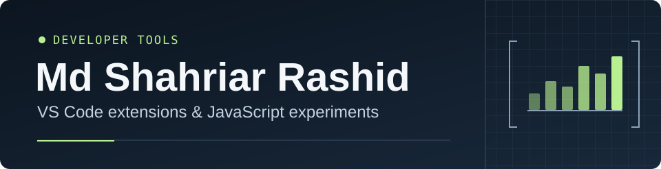

**[Portfolio](https://www.shahriarrashid.com/)** · **[LinkedIn](https://www.linkedin.com/in/shahriarrashid67/)**

## About me

I'm a Senior Software Engineer at Enosis Solutions in Dhaka, Bangladesh. My work spans backend services, cloud infrastructure, and data processing. I build event-driven systems with Node.js and Redis, secure file delivery on Azure, and use Python to process and validate data.

I enjoy figuring out why a system has become slow or hard to change. That might mean reworking a database query, simplifying a legacy code path, or improving how a service authenticates. I also mentor junior engineers through code reviews and help them think through design decisions.

## Tech stack

| Area | Technologies |
| --- | --- |
| **Languages** | JavaScript, TypeScript, Python, C, C++ |
| **Backend & testing** | Node.js, Express.js, Socket.IO, REST APIs, pytest |
| **Frontend** | React, Redux, Next.js, Vite, Material UI, Tailwind CSS |
| **Data & messaging** | PostgreSQL, Redis, Firebase, SQLite |
| **Cloud & DevOps** | Azure Blob Storage, Azure Front Door, Docker, Nginx, Git, GitLab |

## Beyond work

Competitive programming got me into software engineering. At IIUC, I taught data structures and algorithms in three bootcamps, mentored students as a teaching assistant, and wrote problems for university programming contests.

